# Task 2 EDA: Steam reviews for aspect-based opinion mining

Generated 2026-11-16 by `experiments/task2_aspect/eda/07_report.py`. Rerun: see `experiments/task2_aspect/eda/README.md`.

- Raw data: `data/raw/steam.csv.bz2`, 505,939,174 bytes, sha256 `35f4d0c7833220c5209c2319b17911ca446f11b6a7db1971eb4ad33d2b4c2da4`.
- Lexicon: `configs/task2/lexicon.yaml` sha256 `3dfcbe1b520ff801…` (git blob `935ea737fe`). **Status: PRELIMINARY placeholder seed lexicon. Every lexicon-based number (hit rates, aspect shares, purity, game scores, the selection itself) is PRELIMINARY.**
- Environment: Windows-10-10.0.26200-SP0, 12 CPU threads, GPU NVIDIA GeForce RTX 4050 Laptop GPU, 6141 MiB; torch 2.15.0+cpu (CUDA used: False). Config: `configs/task2/eda.yaml`, seed 42. Full versions: `tables/environment.json`.

## Decisions

Hand-written interpretation of the tables below; every number cites its CSV under `tables/`.
Anything that depends on the lexicon is **PRELIMINARY** (placeholder seed lexicon).

### (a) Is the corpus usable? **Yes, with cleaning.**

- 6,417,106 reviews over 9,972 games, 0 malformed rows; 95.4% English (fastText, p >= 0.5;
  97.7% among non-short reviews); **4,817,044 clean English reviews (75.1%)**
  (`overview_counts.csv`).
- 2,346 games have >= 200 clean English reviews, so there is plenty to choose from
  (`reviews_per_game_describe.csv`, `candidate_games.csv`). Volume is very skewed: median 57
  reviews per game, top 1% of games hold 37.5% of reviews (`concentration.json`).
- Must-fix noise: **1,024,687 rows (16%) are the literal placeholder "Early Access Review"**
  (`duplicates_top.csv`); they are removed by the short filter (short = 22.3% of all rows,
  `quality_flags.csv`). Spam-like reviews are rare: 1.3% of all rows, 0.9% of English
  (`quality_flags.csv`).
- Not in the data: timestamps (no time analysis possible) and game names (taken from the Steam
  store API for the shortlist). The text still contains **HTML entities** (`&amp;`, `&gt;`:
  see "d amp d", "c amp c" in `nohit_ngrams.csv`) and Steam's ♥♥♥♥ profanity mask; decode
  entities (`html.unescape`) before labeling.
- Labels are skewed: 82.0% of reviews are recommended (`score_distribution.csv`).

### (b) Recommended games and 9/2/2 train/val/test split — PRELIMINARY

Owner decision (2026-11-16): 13 games split **by game** 9 / 2 / 2 (≈ 69 / 15 / 15), so val and
test games are never seen in training. The 13 are the earlier 10 picks plus their 3 backups.

| split | games |
|---|---|
| train (9) | Lara Croft and the Temple of Osiris (289690), HITMAN (236870), Alien Rage - Unlimited (217920), Test Drive Unlimited 2 (9930), Company of Heroes 2 (231430), Transformers: Rise of the Dark Spark (245760), Battlefleet Gothic: Armada (363680), Toren (320820), Tony Hawk's Pro Skater HD (207210) |
| val (2) | Might & Magic: Heroes VI (48220), Paper Sorcerer (263560) |
| test (2) | Sniper: Ghost Warrior 2 (34870), Two Worlds II HD (7520) |
| backup | Grey Goo (290790), Armikrog (334120), Call of Juarez: The Cartel (33420) |

Source and one-line justifications: `../selected_games.csv`. Genres span action-adventure,
shooters, stealth, racing, skateboarding, turn-based and real-time strategy, a puzzle
platformer, an action RPG and a dungeon crawler. All 13 have >= 7 of the 9 aspects at >= 5%
of their lexicon hits (`selected_games_metrics.csv`). Best of 4,290 partitions
(`split_objective.json`, `split_comparison.csv`): train vs val JS divergence 0.0147 bits,
recommend-share gap 0.003, hit-rate gap 0.017; train vs test 0.0102 bits, 0.003, 0.010.
Known imbalance: **multiplayer** is rarer in val (0.056) and test (0.066) than in train
(0.117), and test reviews are shorter (median 205 vs 295 chars in train).

Check before committing to these: the picks lean **negative** (mean recommend share 0.59 vs
0.82 corpus-wide, `split_comparison.csv`, `score_distribution.csv`) because the score rewards
some criticism; they lean towards **action/shooter**; Transformers has only 226 clean reviews.
Swap in a backup if you want a more positive or less action-heavy set.

### (c) Lexicon hit rate (system A) — PRELIMINARY

- **30.6% of sentences hit >= 1 of the 9 aspects** (32.9% of sentences with >= 4 tokens);
  33.0% incl. `overall`; **67.0% of sentences have no label at all**; 62.9% of reviews have
  at least one aspect hit (`lexicon_hit_rate.csv`). 25.3% of sentences have exactly 1 aspect,
  5.3% have >= 2 (`aspects_per_sentence.csv`).
- Hits are concentrated: gameplay 22.4% and story 19.9% of hits; multiplayer 4.5% and
  difficulty 4.9% are thin (`lexicon_hits_per_aspect.csv`).
- Gaps (`nohit_ngrams.csv`, `topic_aspect_purity.csv`): genre/mode words (*turn-based
  strategy, tower defense, open world, single player, fast paced, hack n slash*), *level
  design*, *replay value*, the word *performance* itself, ratings other than `10/10`
  (*8/10*), combat vocabulary (*weapons, enemies, guns*), *voice/dialogue*, *port*, plus
  evaluative sentences with no aspect (*good, fun, great* top the no-hit unigrams).
- Ambiguous keywords (`keyword_quality.csv`): **worth** — 47% of hits are "worth it/the"
  (overall value, not only price); **recommend** — 16% negated ("not recommend"); **sound** —
  10% "sounds like/good"; **balance** — 9% "balance of"; **hours** — 9% playtime statements.
  The five ambiguous words are correctly never matched; their example uses are in the same
  table.

### (d) BERTopic (system B) and what it implies — purity PRELIMINARY

- Defaults (min_cluster_size 10): **543 topics, 44.5% outliers, mean c_v 0.351**. 30: 210
  topics, 45.1%, 0.359. 100: 65 topics, **50.9% outliers, c_v 0.406**. `reduce_outliers`
  (c-TF-IDF) drops outliers to ~0.6% at similar c_v 0.345–0.416 (`topic_runs.csv`).
- Against lexicon labels, size-weighted purity is only 0.54–0.56; 32–55% of topics are mixed
  and 40–57% have < 20% lexicon coverage (`topic_purity_summary.csv`). Clean aspect topics
  exist for price, story, audio, controls, difficulty, multiplayer, puzzles, graphics,
  combat, crashes and fps; but several large topics are not aspects at all: pure sentiment
  ("good, awesome, terrible"), score lines ("10/10, 8/10"), review meta ("negative review,
  update"), and swearing (`topic_aspect_purity.csv`, `mcs100_reduce-none`).
- Implications: **A** is precise on explicit mentions but covers only ~1/3 of sentences, so
  recall is the problem. **B alone** will not work as a tagger: half the sentences are
  outliers, and forcing them into topics (reduce_outliers) just moves the noise. **Hybrid**:
  lexicon for explicit mentions, BERTopic to (1) find missing terms and aspects and (2) label
  sentences in high-purity topics; leave mixed/sentiment-only topics to `overall`/`other` or
  a classifier. Expect the PEFT classifier to be needed for implicit aspects ("each class has
  2 weapons" → gameplay).

### (e) Aspects possibly missing from the 9

From low-coverage topics and themes (`topic_candidate_themes.csv`,
`topic_aspect_purity.csv`): **developers / updates / support** (3,040 sentences in
matching topics), **community / other players** (3,544), **port / platform quality**
(PC vs console/mobile), **modding / Workshop** (387), **atmosphere / horror** and
**nostalgia** (2,448), plus **controls** and **bugs / stability** which form their own clean
topics but sit inside gameplay/performance today. DLC and refunds fit under price; servers fit
under multiplayer. Decide whether to add 1–2 aspects (devs/updates and community are the
strongest) or map them to `other`.

### (f) Manual-verification workload

Owner decision (2026-11-16): an LLM pre-labels every sentence and the owner verifies, with
**75 reviews per game** over the 13 games: 975 reviews → **7,006 sentences** (6,451 with >= 4
tokens). By sentences the split is train 5,154 (74%) / val 1,001 (14%) / test 851 (12%);
Transformers alone has 977 sentences. At 5–10 s per sentence to verify an LLM label that is
**10–19 hours** (`candidate_sample_summary.csv`). For the original 10 games the 75 reviews
are the first 75 of the same seeded per-game shuffle, i.e. a subset of the earlier
150-review draw, so the sample can grow later without relabeling.

### (g) Risks and open questions

1. The lexicon is a placeholder: hit rates, purity, the game ranking and the split will move
   once it is revised. Rerun `make eda` (cached steps make it cheap) after editing it.
2. The selection score is a heuristic (weights in `configs/task2/eda.yaml`); it favours
   criticised games.
3. The sentence splitter treats 2+ spaces as a former line break, and 10.5% of sentences
   come from chunking unpunctuated run-ons (`sentence_summary.csv`). Check splits in the
   labeling sample before labeling.
4. The topic tokenizer strips `/`, so `10/10` becomes `1010`; harmless for the EDA, but
   handle it in system B.
5. Language ID on very short text is unreliable, but those reviews are dropped as short anyway.
6. Embeddings ran on CPU (CUDA torch was not installed; the 2.7 GB download was too slow).
   Results are the same; only the run time differs.
7. Steps 03/04 of this run were produced by the pre-chunking version of `03_lexicon.py`.
   Counts and hit rates match the current code exactly (checked on the smoke sample); the
   `keyword_quality.csv` example sentences and the ambiguous-word counts (taken from a
   400k-sentence sample) differ. Rerun step 03 to regenerate them with the current code.

## 1. Corpus overview

Schema (no header in the CSV; mapping confirmed by the Task 2 owner): `app_id`, `review_text`, `review_score` (1 recommended / -1 not), `review_votes` (1 = voted helpful at least once; metadata only). **No timestamp and no game-name column**, so there is no time-range analysis; names/genres come from the Steam store API for the shortlisted games only.

| metric | value |
|---|---|
| rows | 6,417,106 |
| columns | 4.000 |
| games (distinct app_id) | 9,972 |
| empty review_text | 7,491 |
| rows whose exact text appears more than once | 2,589,512 |
| distinct texts that are duplicated | 637,110 |
| english rows (fastText lid.176, p>=0.50) | 6,123,774 |
| english share | 0.954 |
| english share among non-short reviews | 0.977 |
| clean english rows (english, not short, not spam) | 4,817,044 |
| clean share of all rows | 0.751 |
| timestamp column available | 0.000 |

_Source: `tables/overview_counts.csv`_

| column | dtype | n_missing_or_empty |
|---|---|---|
| app_id | int32 | 0 |
| review_text | string | 7,491 |
| review_score | int8 | 0 |
| review_votes | int8 | 0 |

_Source: `tables/missing_values.csv`_

### Reviews per game

| metric | games | mean | std | min | p5 | p25 | p50 | p75 | p95 | p99 | max | games_ge_200 | games_ge_1000 |
|---|---|---|---|---|---|---|---|---|---|---|---|---|---|
| n_reviews | 9,972 | 643.512 | 3,102 | 1 | 4.000 | 17 | 57 | 236 | 2,575 | 11,587 | 88,973 | 2,744 | 1,014 |
| n_clean | 9,972 | 483.057 | 2,279 | 0 | 0.000 | 11 | 40 | 179 | 1,959 | 8,560 | 75,603 | 2,346 | 839 |

_Source: `tables/reviews_per_game_describe.csv`_

Concentration: the top 30 games hold 19.9% of all reviews; the top 1% of games hold 37.5% (`tables/concentration.json`).

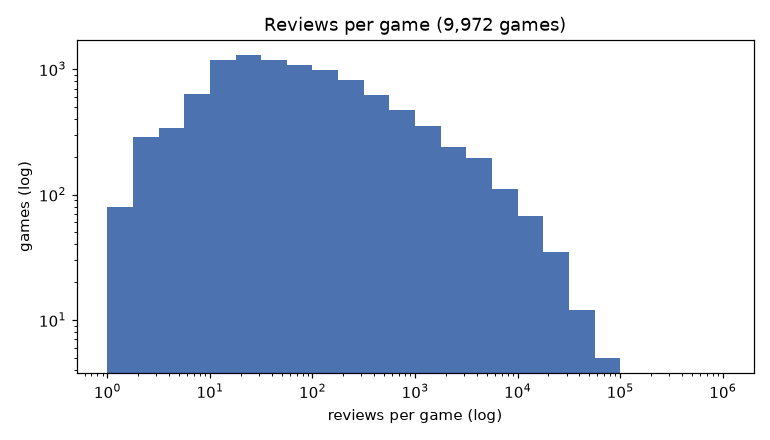

_Reviews per game (log-log)_

| app_id | n_reviews | n_english | n_clean | pos_share_clean |
|---|---|---|---|---|
| 218,620 | 88,973 | 81,967 | 75,603 | 0.681 |
| 221,100 | 88,850 | 88,850 | 0 |  |
| 105,600 | 84,828 | 78,713 | 72,363 | 0.972 |
| 252,490 | 77,037 | 77,037 | 1 | 0.000 |
| 570 | 73,541 | 61,347 | 51,038 | 0.838 |
| 252,950 | 54,227 | 49,791 | 45,367 | 0.941 |
| 391,540 | 51,918 | 49,065 | 46,316 | 0.961 |
| 550 | 50,980 | 46,087 | 41,979 | 0.924 |
| 230,410 | 48,229 | 44,558 | 41,089 | 0.903 |
| 271,590 | 42,374 | 39,033 | 36,059 | 0.724 |
| 301,520 | 41,596 | 41,596 | 0 |  |
| 211,820 | 41,141 | 40,809 | 8,460 | 0.816 |
| 620 | 38,924 | 36,115 | 33,307 | 0.988 |
| 244,850 | 37,453 | 37,445 | 128 | 0.992 |
| 22,380 | 32,963 | 31,092 | 29,138 | 0.955 |
| 107,410 | 32,308 | 29,817 | 27,524 | 0.884 |
| 292,030 | 31,853 | 30,091 | 28,312 | 0.967 |
| 227,940 | 31,303 | 31,039 | 3,858 | 0.577 |
| 8,870 | 31,140 | 29,475 | 27,783 | 0.938 |
| 242,760 | 29,998 | 29,998 | 0 |  |
| 211,420 | 29,598 | 27,974 | 26,172 | 0.878 |
| 444,090 | 28,479 | 28,479 | 0 |  |
| 4,000 | 27,939 | 25,652 | 23,416 | 0.822 |
| 220,200 | 26,544 | 25,955 | 11,282 | 0.961 |
| 222,880 | 26,535 | 24,925 | 23,352 | 0.921 |
| 48,700 | 26,469 | 24,952 | 23,258 | 0.974 |
| 212,680 | 25,936 | 24,880 | 23,522 | 0.969 |
| 251,570 | 25,070 | 25,070 | 0 |  |
| 275,850 | 24,715 | 24,161 | 23,381 | 0.666 |
| 311,210 | 24,543 | 22,794 | 21,216 | 0.562 |

_Source: `tables/top30_games.csv`_

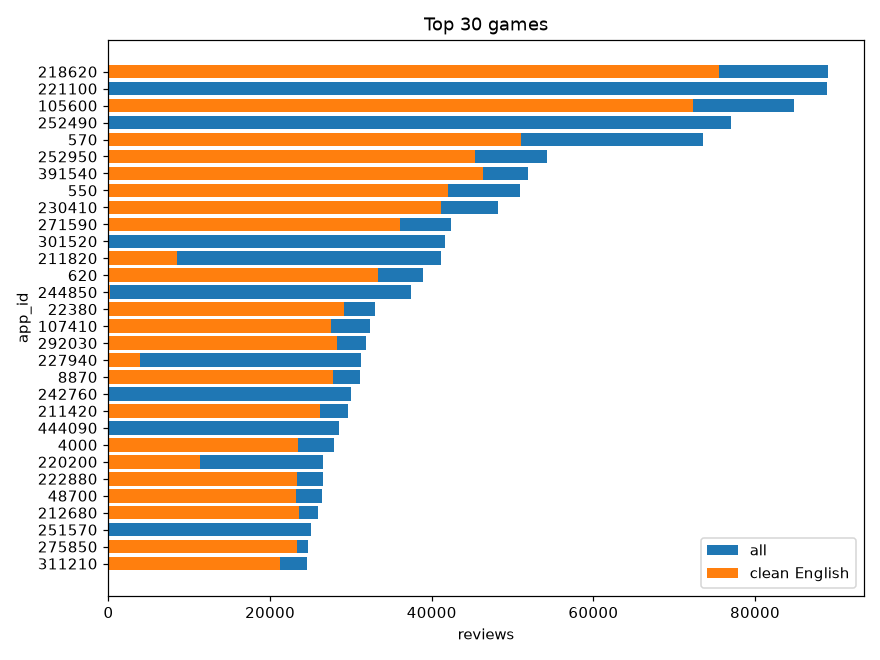

_Top 30 games by review count_

### Language

Detector: fastText `lid.176.ftz` (top-1 label, English if `en` with p >= 0.5). Very short texts are unreliable for any detector, so the share among non-short reviews is also reported in the overview table.

| lang | n | share |
|---|---|---|
| en | 6,336,994 | 0.988 |
| es | 11,837 | 0.002 |
| de | 10,328 | 0.002 |
|  | 7,491 | 0.001 |
| fr | 5,333 | 0.001 |
| it | 4,926 | 0.001 |
| ja | 4,207 | 0.001 |
| pt | 2,956 | 0.001 |
| nl | 2,946 | 0.001 |
| ru | 2,633 | 0.000 |
| lv | 2,538 | 0.000 |
| pl | 2,503 | 0.000 |

_Source: `tables/language_share.csv` (first 12 of 20 rows)_

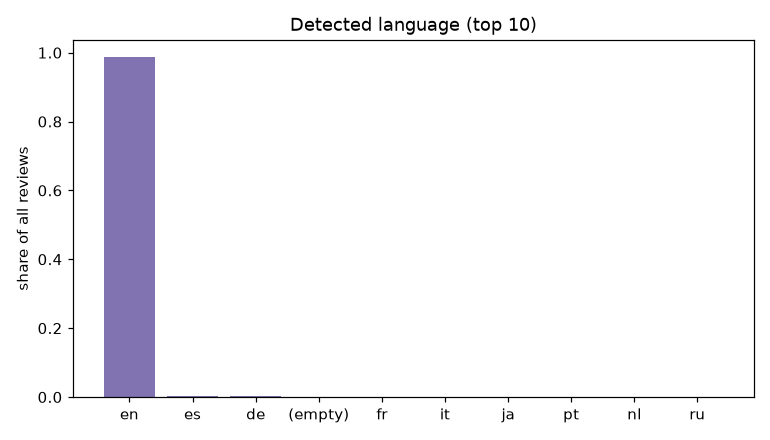

_Detected language_

### Length and quality

| population | metric | mean | p5 | p25 | p50 | p75 | p95 | p99 |
|---|---|---|---|---|---|---|---|---|
| all | n_chars | 302.825 | 19 | 30 | 103 | 309 | 1,232 | 2,970 |
| all | n_words | 55.379 | 3.000 | 6.000 | 19 | 57 | 225 | 537 |
| english | n_chars | 314.348 | 19 | 35 | 112 | 324 | 1,266 | 3,020 |
| english | n_words | 57.567 | 3.000 | 7.000 | 21 | 60 | 231 | 547 |
| clean_english | n_chars | 385.778 | 33 | 75 | 169 | 415 | 1,442 | 3,271 |
| clean_english | n_words | 70.864 | 6.000 | 14 | 32 | 77 | 264 | 592 |

_Source: `tables/length_percentiles.csv`_

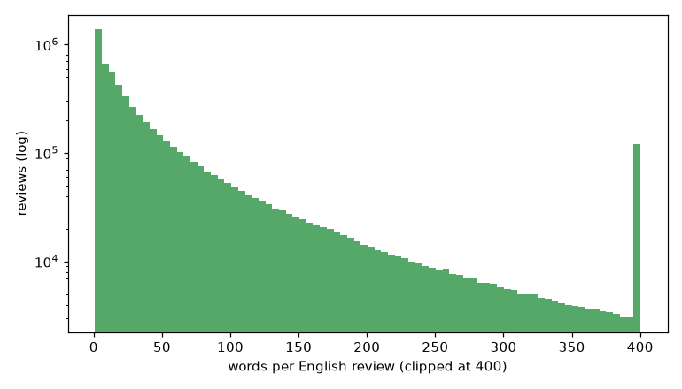

_Words per English review_

Flags (definitions in `configs/task2/eda.yaml` → `filters` and `edalib.text_flags`): short = < 20 chars or < 5 words; spam = any of repeated_chars, low_alnum, ascii_art, self_repeat (compresses to < 15%), copy_paste (identical >= 40-char text posted >= 5 times). A review is **clean** if English, not short, not spam.

| flag | n_all | share_all | n_english | share_english |
|---|---|---|---|---|
| empty | 7,491 | 0.001 | 0 | 0.000 |
| short | 1,431,767 | 0.223 | 1,254,911 | 0.205 |
| repeated_chars | 55,285 | 0.009 | 43,072 | 0.007 |
| low_alnum | 27,669 | 0.004 | 3,961 | 0.001 |
| ascii_art | 5,337 | 0.001 | 921 | 0.000 |
| self_repeat | 3,495 | 0.001 | 1,576 | 0.000 |
| copy_paste | 10,818 | 0.002 | 9,074 | 0.002 |
| spam | 85,019 | 0.013 | 54,079 | 0.009 |

_Source: `tables/quality_flags.csv`_

Most frequent exact-duplicate texts (snippets):

| snippet | dup_count | dup_games |
|---|---|---|
| Early Access Review | 1,024,687 | 1,590 |
|  | 7,491 | 1,610 |
| 10/10 | 6,547 | 1,048 |
| . | 5,041 | 1,359 |
| great game | 4,117 | 817 |
| Great game | 3,934 | 815 |
| Great game! | 2,558 | 712 |
| :) | 2,273 | 577 |
| Nice game | 1,983 | 483 |
| ♥♥♥♥ | 1,863 | 605 |
| cool | 1,813 | 526 |
| Great Game | 1,809 | 495 |
| Great game. | 1,714 | 528 |
| ... | 1,349 | 511 |
| its good | 1,165 | 379 |

_Source: `tables/duplicates_top.csv` (first 15 of 25 rows)_

### Recommend flag

| review_score | review_votes | n | share |
|---|---|---|---|
| -1 | 0 | 878,656 | 0.137 |
| -1 | 1 | 278,030 | 0.043 |
| 1 | 0 | 4,593,566 | 0.716 |
| 1 | 1 | 666,854 | 0.104 |

_Source: `tables/score_distribution.csv`_

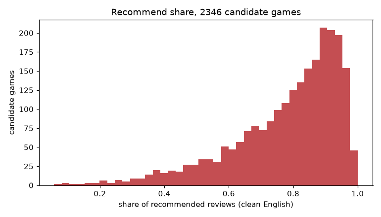

_Share of recommended reviews per candidate game_

## 2. Sentence-level view

Sample: 200 clean English reviews per candidate game (games with >= 200 clean English reviews), uniform random, seed 42. Splitter: line-break/2+-space segments → spaCy `en_core_web_sm` rule-based sentencizer → run-on chunking for segments > 50 tokens (at , ; : and conjunctions). Lemmas from the same spaCy pipeline.

| metric | value |
|---|---|
| sampled reviews | 469,200 |
| sampled games | 2,346 |
| sentences | 2,685,750 |
| sentences per review (mean) | 5.724 |
| sentences per review (median) | 3.000 |
| reviews with a single sentence (share) | 0.221 |
| reviews without any . ! ? (share) | 0.110 |
| sentences produced by run-on chunking (share) | 0.105 |
| sentences with < 4 word tokens (share) | 0.091 |
| words per sentence (mean) | 14.396 |

_Source: `tables/sentence_summary.csv`_

| metric | mean | p5 | p25 | p50 | p75 | p95 | p99 |
|---|---|---|---|---|---|---|---|
| sentences_per_review | 5.724 | 1.000 | 2.000 | 3.000 | 6.000 | 19 | 40 |
| words_per_sentence | 14.396 | 2.000 | 7.000 | 13 | 20 | 33 | 42 |

_Source: `tables/sentence_percentiles.csv`_

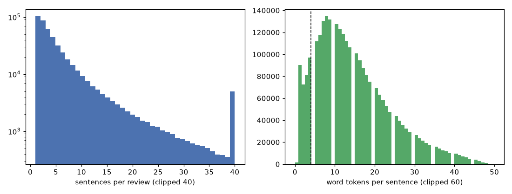

_Sentences per review and words per sentence_

## 3. Lexicon hit rate (system A feasibility) — PRELIMINARY

Matching: whole-token match of lexicon keywords/phrases on lowercase surface tokens and on spaCy lemmas (union), using the library `LexiconMatcher`. Ambiguous words (hard, easy, smooth, free, beautiful) never match on their own.

| population | metric | value |
|---|---|---|
| all_sentences | sentences | 2,685,750 |
| all_sentences | share with >=1 label (9 aspects + overall) | 0.330 |
| all_sentences | share with >=1 of the 9 aspects | 0.306 |
| all_sentences | share with NO hit (implicit/other risk) | 0.670 |
| all_sentences | share with >=2 aspects | 0.053 |
| all_sentences | review-level share with >=1 aspect hit | 0.629 |
| sentences_ge_4_tokens | sentences | 2,440,093 |
| sentences_ge_4_tokens | share with >=1 label (9 aspects + overall) | 0.350 |
| sentences_ge_4_tokens | share with >=1 of the 9 aspects | 0.329 |
| sentences_ge_4_tokens | share with NO hit (implicit/other risk) | 0.650 |
| sentences_ge_4_tokens | share with >=2 aspects | 0.059 |
| sentences_ge_4_tokens | review-level share with >=1 aspect hit | 0.624 |

_Source: `tables/lexicon_hit_rate.csv`_

| aspect | n_sentences | share_of_sentences | share_of_hits |
|---|---|---|---|
| gameplay | 239,766 | 0.089 | 0.224 |
| story | 212,854 | 0.079 | 0.199 |
| price | 127,653 | 0.048 | 0.119 |
| content | 96,599 | 0.036 | 0.090 |
| graphics | 82,199 | 0.031 | 0.077 |
| overall | 81,825 | 0.030 | 0.076 |
| audio | 72,896 | 0.027 | 0.068 |
| performance | 57,590 | 0.021 | 0.054 |
| difficulty | 52,685 | 0.020 | 0.049 |
| multiplayer | 48,297 | 0.018 | 0.045 |

_Source: `tables/lexicon_hits_per_aspect.csv`_

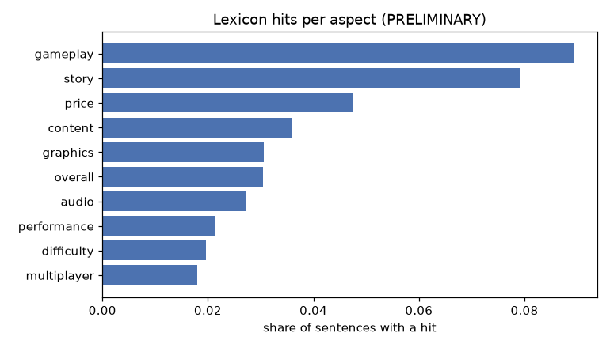

_Hits per aspect_

| n_aspects | n_sentences | share |
|---|---|---|
| 0 | 1,862,786 | 0.694 |
| 1 | 680,100 | 0.253 |
| 2 | 121,338 | 0.045 |
| 3 | 18,732 | 0.007 |
| 4 | 2,447 | 0.001 |
| 5 | 306 | 0.000 |
| 6 | 38 | 0.000 |
| 7 | 3 | 0.000 |

_Source: `tables/aspects_per_sentence.csv`_

Keyword frequency (top 25 and keywords that never matched):

| aspect | keyword | n_sentences |
|---|---|---|
| story | story | 94,546 |
| story | characters | 62,522 |
| overall | recommend | 57,558 |
| gameplay | gameplay | 57,522 |
| content | hours | 55,111 |
| graphics | graphics | 49,713 |
| price | worth | 47,710 |
| story | ending | 41,918 |
| gameplay | puzzle | 41,496 |
| gameplay | controls | 36,817 |
| audio | music | 30,882 |
| gameplay | combat | 29,303 |
| difficulty | challenging | 28,653 |
| price | money | 27,498 |
| price | price | 26,244 |
| gameplay | mechanics | 23,238 |
| price | sale | 22,633 |
| overall | 10/10 | 21,848 |
| audio | sound | 21,038 |
| gameplay | fight | 19,521 |
| performance | bugs | 19,056 |
| gameplay | mission | 18,903 |
| multiplayer | multiplayer | 18,721 |
| difficulty | difficulty | 16,776 |
| gameplay | boss | 16,385 |

_Source: `tables/lexicon_keyword_freq.csv` (first 25 of 75 rows)_

| aspect | keyword | n_sentences |
|---|---|---|

_Source: `tables/lexicon_keyword_freq.csv`_

### No-hit sentences: top n-grams (>= 4 tokens, stop words removed)

| rank | ngram | count | per_1k_nohit_sentences |
|---|---|---|---|
| 1 | good | 100,508 | 63.341 |
| 2 | time | 85,187 | 53.685 |
| 3 | fun | 71,047 | 44.774 |
| 4 | great | 50,732 | 31.972 |
| 5 | thing | 45,145 | 28.451 |
| 6 | feel | 43,075 | 27.146 |
| 7 | want | 41,249 | 25.995 |
| 8 | buy | 40,591 | 25.581 |
| 9 | look | 40,226 | 25.351 |
| 10 | use | 40,137 | 25.295 |
| 11 | love | 39,545 | 24.922 |
| 12 | way | 39,185 | 24.695 |
| 13 | level | 36,951 | 23.287 |
| 14 | find | 36,900 | 23.255 |
| 15 | think | 36,686 | 23.120 |
| 16 | try | 36,427 | 22.957 |
| 17 | lot | 35,308 | 22.251 |
| 18 | bad | 32,863 | 20.710 |
| 19 | need | 31,289 | 19.719 |
| 20 | know | 30,630 | 19.303 |
| 21 | work | 30,364 | 19.136 |
| 22 | people | 28,739 | 18.111 |
| 23 | start | 27,302 | 17.206 |
| 24 | pretty | 27,143 | 17.106 |
| 25 | little | 27,114 | 17.087 |

_Source: `tables/nohit_ngrams.csv` (first 25 of 40 rows)_

| rank | ngram | count | per_1k_nohit_sentences |
|---|---|---|---|
| 1 | long time | 3,729 | 2.350 |
| 2 | pretty good | 3,297 | 2.078 |
| 3 | turn base | 3,104 | 1.956 |
| 4 | old school | 2,831 | 1.784 |
| 5 | look forward | 2,553 | 1.609 |
| 6 | year ago | 2,551 | 1.608 |
| 7 | good thing | 2,485 | 1.566 |
| 8 | single player | 2,441 | 1.538 |
| 9 | little bit | 2,322 | 1.463 |
| 10 | tower defense | 2,313 | 1.458 |
| 11 | year old | 2,302 | 1.451 |
| 12 | fast pace | 2,145 | 1.352 |
| 13 | open world | 2,077 | 1.309 |
| 14 | replay value | 1,976 | 1.245 |
| 15 | level design | 1,959 | 1.235 |
| 16 | pretty fun | 1,897 | 1.196 |
| 17 | click adventure | 1,839 | 1.159 |
| 18 | negative review | 1,825 | 1.150 |
| 19 | half life | 1,791 | 1.129 |
| 20 | bad thing | 1,740 | 1.097 |
| 21 | early access | 1,605 | 1.012 |
| 22 | good way | 1,589 | 1.001 |
| 23 | final fantasy | 1,496 | 0.943 |
| 24 | real life | 1,484 | 0.935 |
| 25 | good time | 1,409 | 0.888 |

_Source: `tables/nohit_ngrams.csv` (first 25 of 40 rows)_

| rank | ngram | count | per_1k_nohit_sentences |
|---|---|---|---|
| 1 | turn base strategy | 910 | 0.574 |
| 2 | super meat boy | 500 | 0.315 |
| 3 | point amp click | 486 | 0.306 |
| 4 | d amp d | 475 | 0.299 |
| 5 | c amp c | 465 | 0.293 |
| 6 | twin stick shooter | 382 | 0.241 |
| 7 | long time ago | 377 | 0.238 |
| 8 | hack n slash | 356 | 0.224 |
| 9 | turn base rpg | 335 | 0.211 |
| 10 | real time strategy | 320 | 0.202 |
| 11 | old school rpg | 256 | 0.161 |
| 12 | quick time event | 214 | 0.135 |
| 13 | grand theft auto | 204 | 0.129 |
| 14 | good tower defense | 199 | 0.125 |
| 15 | good old day | 193 | 0.122 |
| 16 | fast pace action | 192 | 0.121 |
| 17 | single player mode | 190 | 0.120 |
| 18 | amp click adventure | 185 | 0.117 |
| 19 | point n click | 183 | 0.115 |
| 20 | metal gear solid | 170 | 0.107 |
| 21 | blah blah blah | 158 | 0.100 |
| 22 | good turn base | 155 | 0.098 |
| 23 | old school shooter | 148 | 0.093 |
| 24 | long long time | 143 | 0.090 |
| 25 | bullet hell shooter | 139 | 0.088 |

_Source: `tables/nohit_ngrams.csv` (first 25 of 40 rows)_

### Keyword quality check

Five random example sentences per keyword; `[SUSPICIOUS]` marks a configured suspicious context (e.g. *short story*, *sounds like*); `suspicious_share` is over all hits of that keyword. Keywords with a suspicious share above 5%:

| aspect | keyword | n_hits | suspicious_share | suspicious_contexts | example_1 | example_2 |
|---|---|---|---|---|---|---|
| price | worth | 47,710 | 0.466 | worth it; worth the | The rewards are well worth he work. | Overall, it's a good game that's definitely worth checking out. |
| overall | recommend | 57,558 | 0.158 | not recommend; wouldn't recommend; would not recommend; don't recommend; can't recommend | Feels 1000x better than the alpha versions, I would recommend for both the singleplayer and multiplayer experience. | Highly Recommended 9/10 |
| audio | sound | 21,038 | 0.102 | sounds like; sound like; sounds good; sound good; sounds fun; sounds great | TLDR if you like 2D shoot em up's and the main mechanic sounds interesting to you its worth playing. | I had the luxury of having expansions added one at a time, having all 6 expansions available as a bundle sounds amazing, and is a great deal, but will make the  |
| difficulty | balance | 5,149 | 0.088 | balance of | A very nice balance between the randomness and challenge of perma-death featured in most roguelikes, yet also with the ability to keep some of your progress for | Hopefully Blackbird will find a way to balance it so that the less adaptable amongst us can keep up, before too many leave the game behind as a flawed gem in th |
| content | hours | 55,111 | 0.087 | hours played; hours in; hours on record | The campaign is very short, I was able to beat it in less than 4 hours. | I was first introduced to this game as a kid and I spent many many hours playing it. |

_Source: `tables/keyword_quality.csv`_

Ambiguous words (not matched) and how they are used:

| keyword | n_hits | suspicious_share | example_1 | example_2 | example_3 |
|---|---|---|---|---|---|
| beautiful | 2,167 |  | i have not got through all of it yet but just beautiful. | Sure, it's outdated, but it can still surprise you sometimes with the beautiful tropical setting. | The graphics are beautiful, the replayablility is insane, the gameplay is awesome, and the sound is fitting. |
| easy | 4,275 |  | just the simple easy things like that change it a lot. | Quite easy. | This lead to me clearing the first encounter, (which was easy, just rotters) clearing the second encounter (biters and grapplers) then going into the 3rd with a |
| free | 4,128 |  | And it's free, so why not? | There is a game here, where you can go almost anywhere you'd go in a normal casino, and you get 250 free chips every 15 minutes. | Give it a go, it's free so why not. |
| hard | 4,835 | 0.009 | There's no storyline &gt; It's hard as balls to get play &gt; | You have unlimited continues, but if you want to complete the game without continues, the game wil be hard. | Superbe pixel art game, wonderful soundtrack, but hard as hell! |
| smooth | 734 |  | They make an old game that was at times a slog into a smooth experience. | Very Talented developers here, smooth smoooth smooth. | While short the story is worth sticking around for, the gameplay is smooth and the art &amp; graphics are fantastic. |

_Source: `tables/keyword_quality.csv`_

All keywords with all five examples: `tables/keyword_quality.csv`.

### Per game

| statistic | hit_rate | label_rate | aspects_ge_5pct | aspect_entropy | short_sentence_share | sentences |
|---|---|---|---|---|---|---|
| count | 2,346 | 2,346 | 2,346 | 2,346 | 2,346 | 2,346 |
| null_count | 0.000 | 0.000 | 0.000 | 0.000 | 0.000 | 0.000 |
| mean | 0.299 | 0.324 | 6.340 | 0.842 | 0.095 | 1,145 |
| std | 0.074 | 0.071 | 1.074 | 0.075 | 0.024 | 343.419 |
| min | 0.080 | 0.099 | 3.000 | 0.503 | 0.042 | 449 |
| 25% | 0.249 | 0.275 | 6.000 | 0.806 | 0.078 | 891 |
| 50% | 0.297 | 0.321 | 6.000 | 0.856 | 0.091 | 1,102 |
| 75% | 0.347 | 0.368 | 7.000 | 0.894 | 0.107 | 1,348 |
| max | 0.599 | 0.612 | 9.000 | 0.985 | 0.219 | 2,704 |

_Source: `tables/lexicon_per_game_describe.csv`_

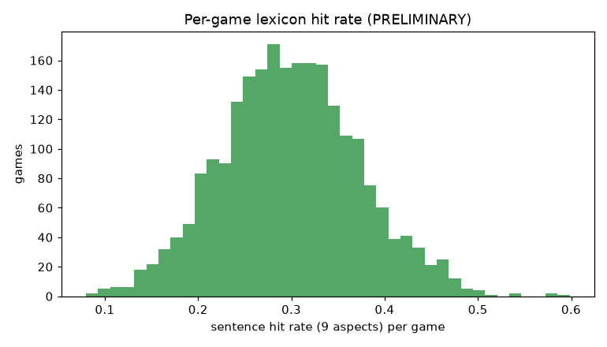

_Per-game hit rate_

## 4. Topic-model feasibility (system B) — purity is PRELIMINARY

Sample: up to 50,000 sentences with >= 4 tokens, equal quota per candidate game, seed 42. Embeddings `sentence-transformers/all-MiniLM-L6-v2`; UMAP {'n_neighbors': 15, 'n_components': 5, 'min_dist': 0.0, 'metric': 'cosine'} fitted once; HDBSCAN `min_cluster_size` in [10, 30, 100] (10 = BERTopic default); c-TF-IDF with English stop words, min_df=5. Outlier reduction: BERTopic `reduce_outliers(strategy='c-tf-idf')` with default threshold 0 (assigns every outlier). Coherence: gensim c_v over the top-10 words, texts tokenized like the vectorizer.

| config | min_cluster_size | reduce_outliers | n_topics | outlier_share | cv_mean | cv_median | largest_topic_share |
|---|---|---|---|---|---|---|---|
| mcs10_reduce-none | 10 | none | 543 | 0.445 | 0.351 | 0.349 | 0.021 |
| mcs10_reduce-c-tf-idf | 10 | c-tf-idf | 543 | 0.006 | 0.345 | 0.338 | 0.021 |
| mcs30_reduce-none | 30 | none | 210 | 0.451 | 0.359 | 0.346 | 0.028 |
| mcs30_reduce-c-tf-idf | 30 | c-tf-idf | 210 | 0.006 | 0.362 | 0.349 | 0.035 |
| mcs100_reduce-none | 100 | none | 65 | 0.509 | 0.406 | 0.387 | 0.038 |
| mcs100_reduce-c-tf-idf | 100 | c-tf-idf | 65 | 0.006 | 0.416 | 0.386 | 0.068 |

_Source: `tables/topic_runs.csv`_

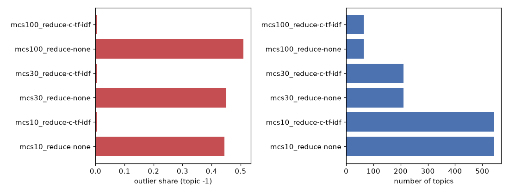

_Topic count and outlier share per setting_

Top 10 topics, `mcs10_reduce-none`:

| config | rank | topic | size | share | cv | top_words |
|---|---|---|---|---|---|---|
| mcs10_reduce-none | 1 | 0 | 1,025 | 0.021 | 0.379 | music soundtrack sound audio sounds effects listen song tracks rhythm |
| mcs10_reduce-none | 2 | 1 | 516 | 0.010 | 0.512 | multiplayer servers single singleplayer online server player local lan players |
| mcs10_reduce-none | 3 | 2 | 389 | 0.008 | 0.430 | ing holy piece kick bull god omg kicking oh olds |
| mcs10_reduce-none | 4 | 3 | 358 | 0.007 | 0.326 | levels level leveling design max rank levelling backtrack complete progress |
| mcs10_reduce-none | 5 | 4 | 342 | 0.007 | 0.551 | hours minutes took hour playtime finished complete finish playthrough 100 |
| mcs10_reduce-none | 6 | 5 | 339 | 0.007 | 0.590 | fps runs settings ram run laptop 60 nvidia rig intel |
| mcs10_reduce-none | 7 | 6 | 326 | 0.006 | 0.523 | difficulty challenge challenging challenges difficulties difficult curve harder hard normal |
| mcs10_reduce-none | 8 | 7 | 324 | 0.006 | 0.344 | developers devs updates developer update dev development updated future abandoned |
| mcs10_reduce-none | 9 | 8 | 320 | 0.006 | 0.145 | 810 910 710 1010 rate rating 110 1110 88 overall |
| mcs10_reduce-none | 10 | 9 | 294 | 0.006 | 0.276 | map maps minimap navigate locations bigger generated custom objectives layout |

_Source: `tables/topic_top10.csv`_

Top 10 topics, `mcs100_reduce-none`:

| config | rank | topic | size | share | cv | top_words |
|---|---|---|---|---|---|---|
| mcs100_reduce-none | 1 | 0 | 1,903 | 0.038 | 0.625 | worth sale price buy money pay bought buying dollars 10 |
| mcs100_reduce-none | 2 | 1 | 1,685 | 0.034 | 0.592 | story ending characters plot endings character end main storyline interesting |
| mcs100_reduce-none | 3 | 2 | 1,372 | 0.027 | 0.642 | weapons enemies enemy weapon guns gun shoot attack kill ammo |
| mcs100_reduce-none | 4 | 3 | 1,178 | 0.024 | 0.352 | thats say good im dont yes bad know wrong really |
| mcs100_reduce-none | 5 | 4 | 1,005 | 0.020 | 0.449 | music soundtrack sound sounds audio effects great listen song track |
| mcs100_reduce-none | 6 | 5 | 885 | 0.018 | 0.731 | controls controller mouse keyboard control xbox keys button support use |
| mcs100_reduce-none | 7 | 6 | 793 | 0.016 | 0.546 | difficulty challenge hard easy challenging simple difficult challenges fun harder |
| mcs100_reduce-none | 8 | 7 | 757 | 0.015 | 0.582 | multiplayer coop online single servers player singleplayer server local players |
| mcs100_reduce-none | 9 | 8 | 756 | 0.015 | 0.515 | puzzles puzzle solve solving difficult easy challenging solution games game |
| mcs100_reduce-none | 10 | 9 | 683 | 0.014 | 0.314 | 1010 810 910 710 rate 10 score overall rating 110 |

_Source: `tables/topic_top10.csv`_

### Topic → aspect purity (lexicon hits as weak labels)

`purity` = share of the topic's lexicon aspect hits that go to its top aspect; `mixed` = purity < 0.5; `low_coverage` = fewer than 20% of its sentences have any lexicon aspect hit.

| config | topics | mixed_share | low_coverage_share | sentences_in_low_coverage_topics | size_weighted_purity |
|---|---|---|---|---|---|
| mcs100_reduce-none | 65 | 0.554 | 0.400 | 8,971 | 0.560 |
| mcs10_reduce-none | 543 | 0.322 | 0.567 | 11,726 | 0.545 |
| mcs30_reduce-none | 210 | 0.524 | 0.457 | 9,972 | 0.562 |

_Source: `tables/topic_purity_summary.csv`_

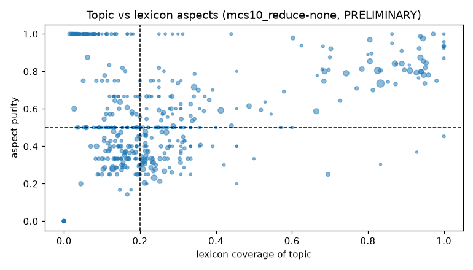

_Topic coverage vs purity_

Largest mixed topics (`mcs10_reduce-none`):

| topic | size | lexicon_coverage | top_aspect | purity | second_aspect | top_words |
|---|---|---|---|---|---|---|
| 2 | 389 | 0.129 | story | 0.278 | price | ing holy piece kick bull god omg kicking oh olds |
| 3 | 358 | 0.237 | gameplay | 0.232 | difficulty | levels level leveling design max rank levelling backtrack complete progress |
| 8 | 320 | 0.128 | story | 0.286 | price | 810 910 710 1010 rate rating 110 1110 88 overall |
| 9 | 294 | 0.207 | gameplay | 0.278 | content | map maps minimap navigate locations bigger generated custom objectives layout |
| 12 | 260 | 0.269 | gameplay | 0.474 | price | ship ships crew boat captain bigger sea control managing pirates |
| 14 | 231 | 0.212 | gameplay | 0.321 | story | shooter shooters bullet person gun thirdperson hell gunplay guns metal |
| 20 | 201 | 0.214 | gameplay | 0.477 | price | controller keyboard xbox support pad 360 mouse using keys setup |
| 24 | 184 | 0.212 | gameplay | 0.204 | price | racing race races racer burnout car cars dirt competition gears |
| 25 | 182 | 0.231 | gameplay | 0.333 | difficulty | ai career stupid ais intelligent controlled predictable human smart obnoxious |
| 26 | 178 | 0.208 | gameplay | 0.317 | multiplayer | tutorial tutorials instructions guide help learn explains beginners videos understanding |
| 27 | 175 | 0.086 | price | 0.400 | audio | 1010 1110 010 110 suicide 910 die lose life 10 |
| 29 | 166 | 0.235 | gameplay | 0.312 | story | zombies zombie apocalypse nazi survival survivors scenario killing lab appear |

_Source: `tables/topic_aspect_purity.csv` (first 12 of 175 rows)_

Largest low-coverage topics (`mcs10_reduce-none`) — candidates for aspects the lexicon misses:

| topic | size | lexicon_coverage | candidate_theme | top_words | example |
|---|---|---|---|---|---|
| 2 | 389 | 0.129 |  | ing holy piece kick bull god omg kicking oh olds | omg your missing all the FUN and free ♥♥♥♥ man get a pc you dum ♥♥♥ ! |
| 8 | 320 | 0.128 |  | 810 910 710 1010 rate rating 110 1110 88 overall | This is a game like no other 10/10 |
| 18 | 210 | 0.148 |  | steam store glad bought product picked library kid sale trolling | I doubt anyone is ever going to look for this game on steam without fully being aware what this is, and no one is going to read reviews for  |
| 23 | 186 | 0.027 |  | best favorite favourite played ive games year greatest bro delight | One of the best games ever, a classic. |
| 27 | 175 | 0.086 |  | 1010 1110 010 110 suicide 910 die lose life 10 | 6,5/10 would defeat again |
| 31 | 162 | 0.167 |  | humor jokes humour funny laugh comedy references laughing cringeworthy humorous | I would recommend this to anyone who has a weirdly dark sense of humour, especially if you play as a Malkavian. |
| 34 | 155 | 0.103 | community | friends friend friendship play strangers buddies fun party mount group | Cool game -Nice player communication -Shoot every where my friend -Capture the flag -Be proud |
| 37 | 153 | 0.059 |  | fun overall amazingly lot alot losing satisfying play super loads | This game is past its prime, but can be a lot of fun. |
| 39 | 153 | 0.131 | devs_updates | review reviews negative positive write update writing read changing wrote | Now for the actual review. |
| 46 | 129 | 0.062 |  | recommend recommendation product highly recommending recomend patient recommended unsure check | Would recommend this over HLDM Source, definitely. |
| 47 | 127 | 0.150 |  | eyes colors color eye dark bright lighting lights darkness colorful | Or just get Black Mesa, then you will at least get something that is prettier on the eyes and functioning like it should. |
| 50 | 123 | 0.179 |  | units troops unit tank soldiers army soldier factions faction military | I personally do not want to sit in a tank, or on a boat and use artillery, or call in air strikes or shoot people from a helicopter. |
| 51 | 119 | 0.160 |  | japanese russian language translation english foreign learning chinese tool correct | It's good if you like people yelling at you in different languages |
| 52 | 113 | 0.044 |  | terrible bad horrible awful mean mediocre isnt saying wasnt named | This game is too bad.. it should dissapear. |
| 53 | 112 | 0.107 |  | vive experiences virtual experience introduction tech showcase implementation suspect intro | especially if communicating via headphones |
| 54 | 111 | 0.117 | modding,community | mods mod modding community support source fallout recognition supports vanilla | This Game is still popular to this day, with countless game mods and mods, another really well made Valve Game. |
| 58 | 107 | 0.159 |  | achievements achievement showcase 100 easy specific spell click guides swear | a cs 1.6 but with kinda achievements :) cute 8/10 |
| 59 | 106 | 0.170 |  | cars driving car vehicles vehicle drive handling driver traffic wheels | the driving is awsome, the damage beats any forza, |
| 61 | 104 | 0.106 |  | buy buying considering purchase fence ff bang havent purchasing reasons | Be sure to Buy/Play it. |
| 63 | 97 | 0.134 |  | free plus fact charge lose week insult word fricken programmers | Be sure to check it out, it's free after all. |

_Source: `tables/topic_aspect_purity.csv` (first 20 of 308 rows)_

Candidate themes (topic top-words matched to `topics.candidate_themes` in the config):

| theme | topics | low_coverage_topics | sentences | configs |
|---|---|---|---|---|
| community | 18 | 14 | 3,544 | mcs100_reduce-none,mcs10_reduce-none,mcs30_reduce-none |
| devs_updates | 18 | 8 | 3,040 | mcs100_reduce-none,mcs10_reduce-none,mcs30_reduce-none |
| nostalgia | 25 | 11 | 2,448 | mcs100_reduce-none,mcs10_reduce-none,mcs30_reduce-none |
| controls | 8 | 0 | 2,041 | mcs100_reduce-none,mcs10_reduce-none,mcs30_reduce-none |
| servers | 7 | 0 | 2,003 | mcs100_reduce-none,mcs10_reduce-none,mcs30_reduce-none |
| bugs | 9 | 0 | 1,473 | mcs100_reduce-none,mcs10_reduce-none,mcs30_reduce-none |
| dlc | 7 | 0 | 656 | mcs100_reduce-none,mcs10_reduce-none,mcs30_reduce-none |
| modding | 5 | 5 | 387 | mcs100_reduce-none,mcs10_reduce-none,mcs30_reduce-none |
| refunds | 3 | 0 | 133 | mcs10_reduce-none,mcs30_reduce-none |
| early_access | 3 | 3 | 127 | mcs10_reduce-none,mcs30_reduce-none |
| cheating | 3 | 3 | 107 | mcs10_reduce-none,mcs30_reduce-none |

_Source: `tables/topic_candidate_themes.csv`_

## 5. Game selection — PRELIMINARY (depends on the lexicon)

Candidates: games with >= 200 clean English reviews. Score = weighted sum of z-scores (hit_rate×1.0, aspect_entropy×1.0, aspects_ge_5pct×0.5, informative_share×1.0, log_n_clean×0.25, negative_share_capped×0.5). Steam metadata fetched for the top 150; then greedy picks with at least 3 games having >= 25% negative reviews, at most 1 game per primary SteamSpy tag and 4 per Steam genre. Genres come from the Steam store / SteamSpy, not inferred from names. Split by game: all 9/2/2 (train/val/test) partitions searched, minimizing, for val and for test against train, JS divergence of mean aspect profiles + ½ gap in recommend share + ½ gap in hit rate, with >= 1 negative-heavy game in both val and test.

| game_id | name | split | justification |
|---|---|---|---|
| 289690 | LARA CROFT AND THE TEMPLE OF OSIRIS™ | train | Puzzle; 402 clean EN reviews, 57% negative; lexicon hit rate 41%, 8 aspects >=5% (top: gameplay 25%, multiplayer 19%, performance 16%) |
| 34870 | Sniper: Ghost Warrior 2 | test | Sniper; 1,335 clean EN reviews, 37% negative; lexicon hit rate 40%, 8 aspects >=5% (top: story 18%, gameplay 15%, price 14%) |
| 236870 | HITMAN™ | train | Stealth; 3,563 clean EN reviews, 38% negative; lexicon hit rate 36%, 8 aspects >=5% (top: gameplay 23%, price 18%, multiplayer 14%) |
| 217920 | Alien Rage - Unlimited | train | Shooter; 452 clean EN reviews, 29% negative; lexicon hit rate 40%, 8 aspects >=5% (top: gameplay 21%, story 15%, performance 14%) |
| 9930 | Test Drive Unlimited 2 | train | Racing; 1,929 clean EN reviews, 46% negative; lexicon hit rate 30%, 9 aspects >=5% (top: price 24%, multiplayer 22%, story 10%) |
| 48220 | Might & Magic: Heroes VI | val | Turn-Based Strategy; 1,950 clean EN reviews, 65% negative; lexicon hit rate 29%, 8 aspects >=5% (top: performance 19%, price 18%, story 12%) |
| 231430 | Company of Heroes 2 | train | World War II; 9,845 clean EN reviews, 29% negative; lexicon hit rate 35%, 8 aspects >=5% (top: price 26%, gameplay 17%, multiplayer 14%) |
| 7520 | Two Worlds II HD | test | Third Person; 1,517 clean EN reviews, 46% negative; lexicon hit rate 35%, 8 aspects >=5% (top: gameplay 25%, story 21%, price 18%) |
| 245760 | TRANSFORMERS: Rise of the Dark Spark | train | Robots; 226 clean EN reviews, 62% negative; lexicon hit rate 38%, 7 aspects >=5% (top: story 32%, gameplay 14%, price 13%) |
| 263560 | Paper Sorcerer | val | Dungeon Crawler; 366 clean EN reviews, 17% negative; lexicon hit rate 41%, 8 aspects >=5% (top: gameplay 29%, story 16%, audio 13%) |
| 363680 | Battlefleet Gothic: Armada (Classic) | train | Warhammer 40K; 1,879 clean EN reviews, 30% negative; lexicon hit rate 35%, 8 aspects >=5% (top: gameplay 26%, story 21%, multiplayer 10%) |
| 320820 | Toren | train | Puzzle-Platformer; 332 clean EN reviews, 35% negative; lexicon hit rate 46%, 7 aspects >=5% (top: story 28%, gameplay 26%, graphics 14%) |
| 207210 | Tony Hawks Pro Skater HD | train | Sports; 787 clean EN reviews, 41% negative; lexicon hit rate 29%, 8 aspects >=5% (top: price 22%, gameplay 19%, graphics 12%) |
| 290790 | Grey Goo | backup | RTS; 1,676 clean EN reviews, 30% negative; lexicon hit rate 28%, 9 aspects >=5% (top: story 24%, gameplay 20%, price 13%) |
| 334120 | Armikrog | backup | Point & Click; 462 clean EN reviews, 53% negative; lexicon hit rate 38%, 7 aspects >=5% (top: gameplay 25%, story 21%, audio 14%) |
| 33420 | Call of Juarez: The Cartel | backup | FPS; 213 clean EN reviews, 65% negative; lexicon hit rate 34%, 8 aspects >=5% (top: story 28%, gameplay 15%, price 12%) |

_Source: `selected_games.csv`_

| app_id | name | split | primary_tag | n_clean | median_chars_clean | hit_rate | aspects_ge_5pct | aspect_entropy | informative_share | pos_share_clean | score |
|---|---|---|---|---|---|---|---|---|---|---|---|
| 290,790 | Grey Goo | backup | RTS | 1,676 | 279.500 | 0.280 | 9 | 0.937 | 0.969 | 0.696 | 3.087 |
| 334,120 | Armikrog | backup | Point & Click | 462 | 501 | 0.379 | 7 | 0.874 | 0.964 | 0.470 | 3.021 |
| 33,420 | Call of Juarez: The Cartel | backup | FPS | 213 | 251 | 0.341 | 8 | 0.918 | 0.925 | 0.352 | 3.016 |
| 34,870 | Sniper: Ghost Warrior 2 | test | Sniper | 1,335 | 170 | 0.399 | 8 | 0.962 | 0.939 | 0.634 | 4.448 |
| 7,520 | Two Worlds II HD | test | Third Person | 1,517 | 240 | 0.354 | 8 | 0.891 | 0.948 | 0.544 | 3.321 |
| 289,690 | LARA CROFT AND THE TEMPLE OF OSIRIS™ | train | Puzzle | 402 | 264.500 | 0.411 | 8 | 0.911 | 0.983 | 0.428 | 4.552 |
| 236,870 | HITMAN™ | train | Stealth | 3,563 | 353 | 0.362 | 8 | 0.926 | 0.970 | 0.619 | 4.028 |
| 217,920 | Alien Rage - Unlimited | train | Shooter | 452 | 285.500 | 0.396 | 8 | 0.956 | 0.962 | 0.715 | 4.018 |
| 9,930 | Test Drive Unlimited 2 | train | Racing | 1,929 | 178 | 0.304 | 9 | 0.929 | 0.942 | 0.536 | 3.642 |
| 231,430 | Company of Heroes 2 | train | World War II | 9,845 | 170 | 0.349 | 8 | 0.919 | 0.940 | 0.711 | 3.388 |
| 245,760 | TRANSFORMERS: Rise of the Dark Spark | train | Robots | 226 | 375.500 | 0.383 | 7 | 0.894 | 0.966 | 0.376 | 3.193 |
| 363,680 | Battlefleet Gothic: Armada (Classic) | train | Warhammer 40K | 1,879 | 313 | 0.347 | 8 | 0.917 | 0.957 | 0.698 | 3.165 |
| 320,820 | Toren | train | Puzzle-Platformer | 332 | 472 | 0.456 | 7 | 0.830 | 0.991 | 0.648 | 3.146 |
| 207,210 | Tony Hawks Pro Skater HD | train | Sports | 787 | 242 | 0.293 | 8 | 0.939 | 0.980 | 0.595 | 3.112 |
| 48,220 | Might & Magic: Heroes VI | val | Turn-Based Strategy | 1,950 | 223 | 0.287 | 8 | 0.947 | 0.964 | 0.349 | 3.521 |
| 263,560 | Paper Sorcerer | val | Dungeon Crawler | 366 | 318.500 | 0.413 | 8 | 0.886 | 0.992 | 0.828 | 3.173 |

_Source: `tables/selected_games_metrics.csv`_

| metric | train | val | test |
|---|---|---|---|
| share_gameplay | 0.199 | 0.195 | 0.202 |
| share_story | 0.162 | 0.142 | 0.197 |
| share_graphics | 0.085 | 0.095 | 0.109 |
| share_audio | 0.049 | 0.072 | 0.052 |
| share_performance | 0.086 | 0.133 | 0.099 |
| share_price | 0.155 | 0.142 | 0.159 |
| share_multiplayer | 0.117 | 0.056 | 0.066 |
| share_difficulty | 0.059 | 0.074 | 0.036 |
| share_content | 0.088 | 0.091 | 0.079 |
| hit_rate | 0.367 | 0.350 | 0.377 |
| pos_share_clean | 0.592 | 0.588 | 0.589 |
| aspect_entropy | 0.913 | 0.916 | 0.926 |
| median_chars_clean | 294.833 | 270.750 | 205 |
| games | 9.000 | 2.000 | 2.000 |

_Source: `tables/split_comparison.csv`_

- train vs val: JS divergence 0.0147 bits, recommend-share gap 0.003, hit-rate gap 0.017
- train vs test: JS divergence 0.0102 bits, recommend-share gap 0.003, hit-rate gap 0.010

Best of 4,290 partitions (`tables/split_objective.json`).

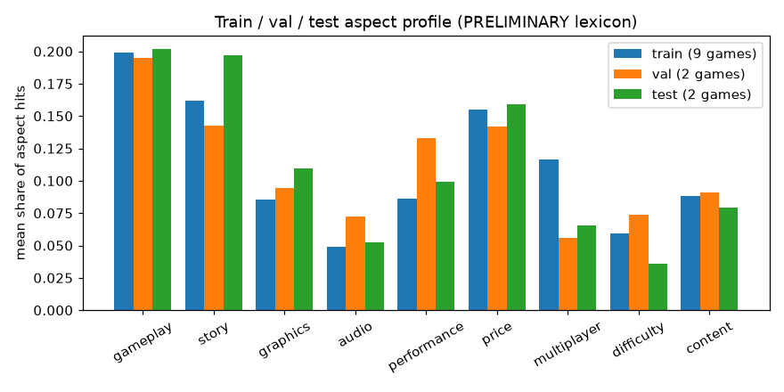

_Train / val / test aspect profile_

Top 20 scored candidates:

| app_id | name | primary_tag | score | n_clean | hit_rate | aspects_ge_5pct | aspect_entropy | informative_share | pos_share_clean |
|---|---|---|---|---|---|---|---|---|---|
| 289,690 | LARA CROFT AND THE TEMPLE OF OSIRIS™ | Puzzle | 4.552 | 402 | 0.411 | 8 | 0.911 | 0.983 | 0.428 |
| 34,870 | Sniper: Ghost Warrior 2 | Sniper | 4.448 | 1,335 | 0.399 | 8 | 0.962 | 0.939 | 0.634 |
| 236,870 | HITMAN™ | Stealth | 4.028 | 3,563 | 0.362 | 8 | 0.926 | 0.970 | 0.619 |
| 217,920 | Alien Rage - Unlimited | Shooter | 4.018 | 452 | 0.396 | 8 | 0.956 | 0.962 | 0.715 |
| 272,470 | The Incredible Adventures of Van Helsing II | Hack and Slash | 3.969 | 672 | 0.388 | 8 | 0.923 | 0.963 | 0.601 |
| 255,070 | Abyss Odyssey | Action Roguelike | 3.877 | 1,015 | 0.417 | 8 | 0.877 | 0.972 | 0.618 |
| 400,170 | The Incredible Adventures of Van Helsing: Final Cut | Hack and Slash | 3.877 | 337 | 0.388 | 9 | 0.928 | 0.955 | 0.715 |
| 252,350 | Double Dragon: Neon | Beat 'em up | 3.813 | 854 | 0.356 | 9 | 0.933 | 0.977 | 0.747 |
| 275,610 | Warhammer 40,000: Kill Team | Warhammer 40K | 3.812 | 371 | 0.336 | 8 | 0.940 | 0.974 | 0.474 |
| 214,870 | Painkiller Hell & Damnation | FPS | 3.732 | 649 | 0.369 | 8 | 0.947 | 0.959 | 0.675 |
| 256,190 | Enemy Front | FPS | 3.731 | 763 | 0.363 | 7 | 0.933 | 0.968 | 0.499 |
| 265,300 | Lords Of The Fallen™ 2014 | Souls-like | 3.701 | 3,040 | 0.398 | 7 | 0.881 | 0.975 | 0.552 |
| 9,930 | Test Drive Unlimited 2 | Racing | 3.642 | 1,929 | 0.304 | 9 | 0.929 | 0.942 | 0.536 |
| 310,950 | Street Fighter V | Fighting | 3.587 | 4,085 | 0.415 | 6 | 0.887 | 0.959 | 0.514 |
| 243,470 | Watch_Dogs™ | Hacking | 3.543 | 7,603 | 0.355 | 7 | 0.919 | 0.956 | 0.581 |
| 48,220 | Might & Magic: Heroes VI | Turn-Based Strategy | 3.521 | 1,950 | 0.287 | 8 | 0.947 | 0.964 | 0.349 |
| 365,590 | Tom Clancy’s The Division™ | Looter Shooter | 3.517 | 12,868 | 0.364 | 7 | 0.912 | 0.946 | 0.605 |
| 27,940 | Dead Horde | Survival | 3.506 | 239 | 0.327 | 8 | 0.938 | 0.968 | 0.301 |
| 49,540 | Aliens: Colonial Marines Collection | FPS | 3.470 | 2,927 | 0.354 | 7 | 0.911 | 0.953 | 0.484 |
| 289,650 | Assassin's Creed® Unity | Assassins | 3.402 | 4,584 | 0.383 | 7 | 0.863 | 0.961 | 0.454 |

_Source: `tables/game_candidates_scored.csv` (first 20 of 2346 rows)_

## 6. Candidate labeling sample (not labeled, not committed)

`data/processed/candidate_sample.csv` and `.jsonl`: 75 clean English reviews per selected game, uniform random from the game's full clean pool, seed 42, same splitter. Columns: game_id, game_name, split, review_id (raw CSV row number), sentence_id (`<review_id>-<k>`), sentence, recommended, n_words. Workload assumes [5, 10] seconds to verify one LLM label.

| game_id | game_name | split | reviews | sentences | informative_sentences | recommended_share | verify_hours_low | verify_hours_high |
|---|---|---|---|---|---|---|---|---|
| 48,220 | Might & Magic: Heroes VI | val | 75 | 437 | 405 | 0.359 | 0.607 | 1.214 |
| 263,560 | Paper Sorcerer | val | 75 | 564 | 538 | 0.825 | 0.783 | 1.567 |
| 9,930 | Test Drive Unlimited 2 | train | 75 | 425 | 386 | 0.499 | 0.590 | 1.181 |
| 207,210 | Tony Hawks Pro Skater HD | train | 75 | 386 | 362 | 0.474 | 0.536 | 1.072 |
| 217,920 | Alien Rage - Unlimited | train | 75 | 561 | 509 | 0.674 | 0.779 | 1.558 |
| 231,430 | Company of Heroes 2 | train | 75 | 462 | 422 | 0.411 | 0.642 | 1.283 |
| 236,870 | HITMAN™ | train | 75 | 555 | 509 | 0.540 | 0.771 | 1.542 |
| 245,760 | TRANSFORMERS: Rise of the Dark Spark | train | 75 | 977 | 890 | 0.172 | 1.357 | 2.714 |
| 289,690 | LARA CROFT AND THE TEMPLE OF OSIRIS™ | train | 75 | 545 | 500 | 0.501 | 0.757 | 1.514 |
| 320,820 | Toren | train | 75 | 682 | 626 | 0.689 | 0.947 | 1.894 |
| 363,680 | Battlefleet Gothic: Armada (Classic) | train | 75 | 561 | 522 | 0.590 | 0.779 | 1.558 |
| 7,520 | Two Worlds II HD | test | 75 | 459 | 426 | 0.588 | 0.637 | 1.275 |
| 34,870 | Sniper: Ghost Warrior 2 | test | 75 | 392 | 356 | 0.732 | 0.544 | 1.089 |
|  | TOTAL |  | 975 | 7,006 | 6,451 |  | 9.731 | 19.461 |

_Source: `tables/candidate_sample_summary.csv`_
